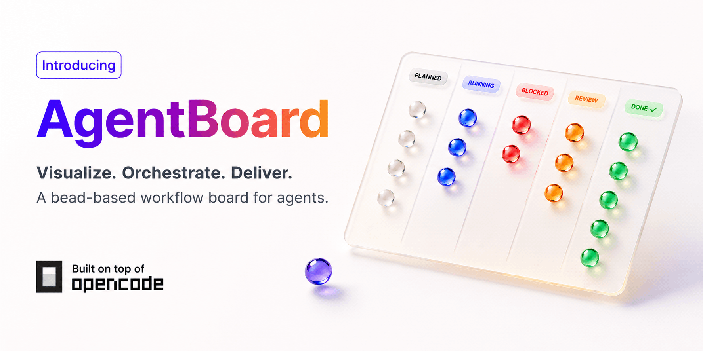
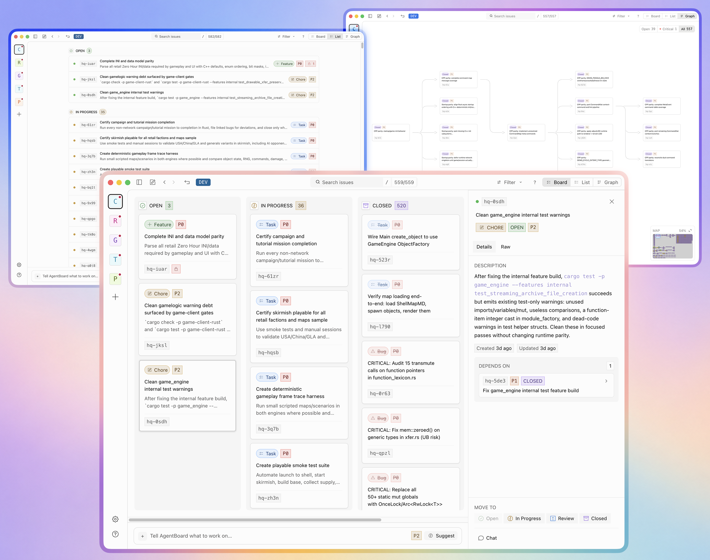
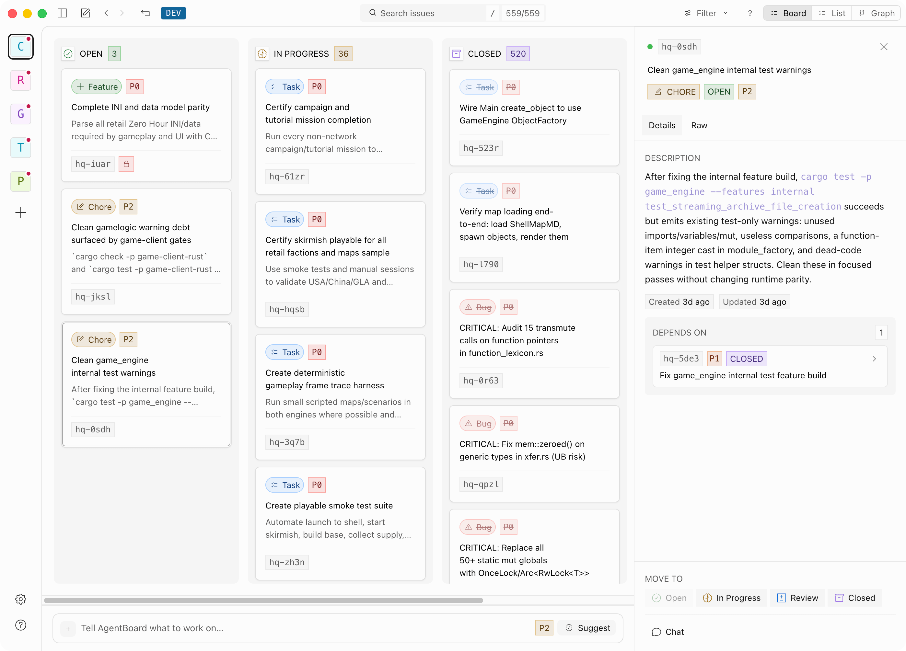
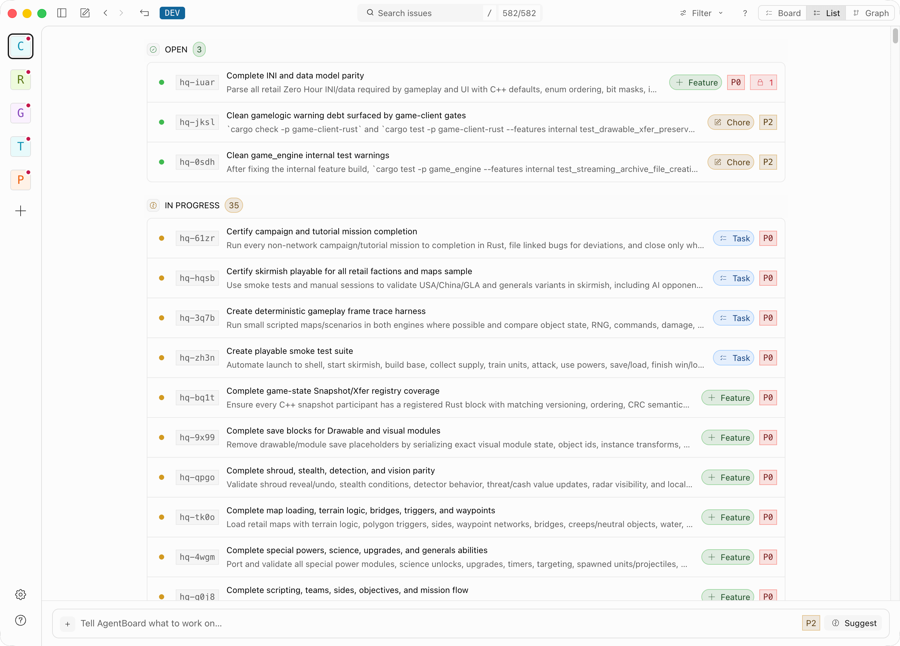
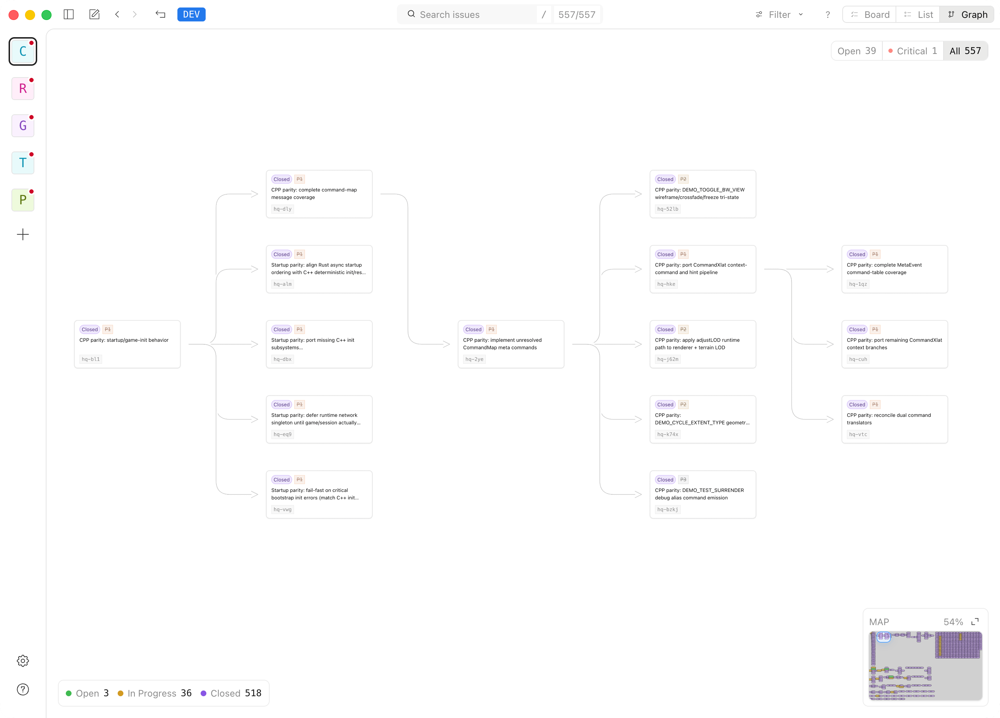

<p align="center">
  
</p>

AgentBoard turns your [Beads](https://github.com/gastownhall/beads) issues into a workspace where you and your coding models can plan, review, and hand off work together.

Instead of scattering tasks across long chat histories, it provides **three synchronized views** of the same local issue graph:

- **Board** — Kanban columns (Open → In Progress → Needs Review → Closed)
- **List** — Fast scanning of large backlogs
- **Graph** — Interactive dependency map with zoom, pan, minimap, and manual layout

Beads stores issues, labels, and dependencies in your project. OpenCode manages chat and model runs.

<p align="center">
  <picture>
    <source media="(prefers-color-scheme: dark)" srcset="assets/three-dark.png">
    
  </picture>
</p>

## Why AgentBoard

AgentBoard took inspiration from [OpenAI Symphony](https://openai.com/index/introducing-openai-symphony/), [Cursor’s agent Kanban example](https://github.com/cursor/cookbook/tree/main/sdk/agent-kanban), and [Hermes Agent’s Kanban board](https://hermes-agent.nousresearch.com/docs/user-guide/features/kanban).

AgentBoard uses [Beads](https://github.com/gastownhall/beads), a lightweight local-first issue tracker that many models already know natively. The UI works inside the [OpenCode](https://github.com/anomalyco/opencode) desktop environment.

If you already use Beads, open your project in AgentBoard to see the same issues and dependencies.

## Features

- **Kanban Board** — Drag cards between columns to update their Beads status
- **Interactive Dependency Graph** — Zoom, pan, minimap, filters, and manual node positioning
- **List View** — Scan hundreds of tasks
- **Rich Issue Drawer** — Dependencies, timeline, artifacts, priority, and quick actions
- **One-click Chat Handoff** — Open an unsent OpenCode draft with context for the selected issue
- **Inline Issue Creation** — Create tasks from the composer and optionally continue straight into chat
- **Local-first** — Beads database remains the single source of truth for status, priority, and dependencies

<table>
  <tr>
    <td width="50%">
      
      <br>
      <sub><strong>Board</strong> — Move work through its lifecycle and inspect an issue without losing context.</sub>
    </td>
    <td width="50%">
      
      <br>
      <sub><strong>List</strong> — Scan a large backlog with status, type, and priority visible at a glance.</sub>
    </td>
  </tr>
  <tr>
    <td colspan="2">
      
      <br>
      <sub><strong>Graph</strong> — Explore dependency chains with filters, zoom controls, and a minimap.</sub>
    </td>
  </tr>
</table>

## Get started

Install Bun **1.4.4** and put the Beads `bd` CLI on your PATH.

```bash
git clone --branch agent-board https://github.com/bernaferrari/agent-board.git
cd agent-board
bun install --frozen-lockfile
bun run dev:desktop
```

1. Open your project in the OpenCode desktop app.
2. Select the project in **Home**, then click **AgentBoard**. You can also open **AgentBoard** from the project’s menu.
3. If the project has no Beads tracker, use the setup prompt to initialize it.

For run controls and notes on upgrading from an older checkout, see [AgentBoard setup and usage](docs/agentboard.md).

## Philosophy

This fork was built after studying [OpenAI Symphony](https://openai.com/index/introducing-openai-symphony/), [Cursor's agent Kanban](https://github.com/cursor/cookbook/tree/main/sdk/agent-kanban), and [beads-ui](https://github.com/mantoni/beads-ui). The goal is a lightweight, uncoupled interface that works with any model that already understands Beads, rather than forcing yet another custom system. Although OpenCode is helpful for some chat features, it is easy to extract AgentBoard into its own desktop client or add as part of any existing app/IDE. There are a few styling and UI components being reused from OpenCode, but nothing that can't be easily if needed.

This fork follows upstream OpenCode. Feedback and contributions are welcome.
