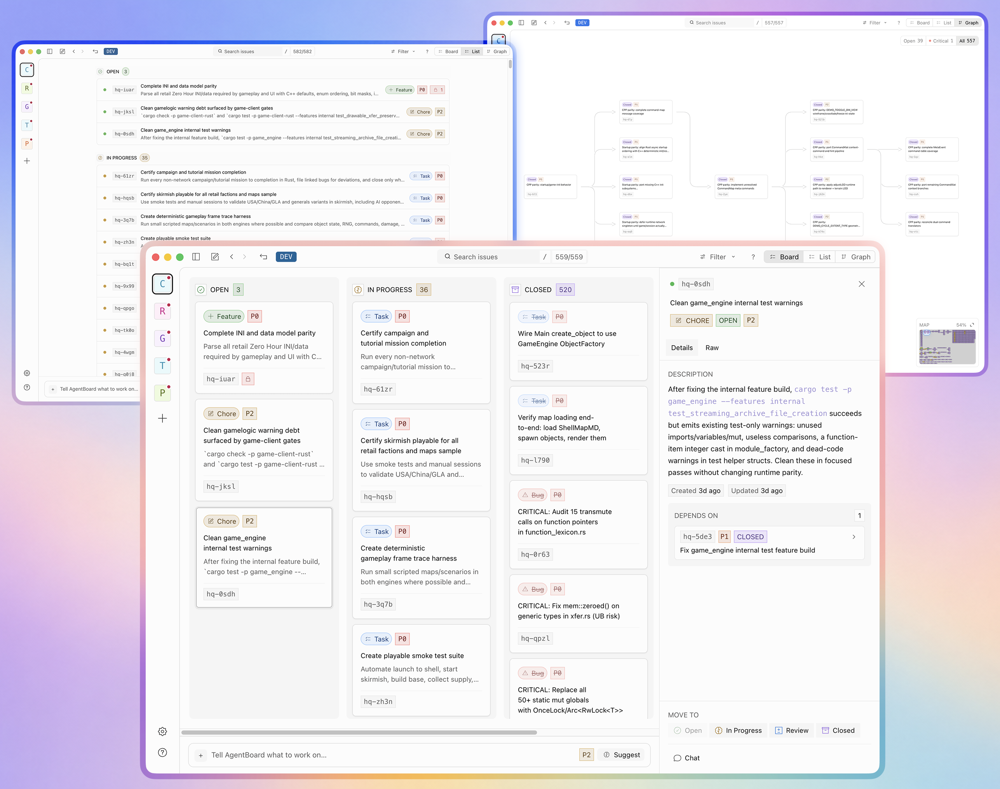

# AgentBoard in OpenCode

AgentBoard uses the Beads tracker in your project. OpenCode runs sessions and stores their AgentBoard history in its local database. Board, List, and Graph show the same issues and dependencies.

## Run from source

Install Bun 1.4.4 and put the Beads `bd` CLI on the server's PATH. From this checkout, run:

```sh
bun install --frozen-lockfile
bun run dev:desktop
```

In OpenCode, add or open your project. In Home, choose **AgentBoard** for the selected project, or use **AgentBoard** in the project's menu. If the project has no tracker, AgentBoard offers to initialize Beads. Existing trackers open with their issues and labels.

**Chat** opens an unsent OpenCode draft in the same project. **Run** starts an OpenCode session with the issue prompt. Set up a model in OpenCode before starting a run. After the turn completes, AgentBoard shows the response, diff, and review brief. **Mark done** closes the issue in Beads.

When upgrading an older AgentBoard dev checkout that used a separate database, set `OPENCODE_DB` to that database's absolute path before starting OpenCode so it can still find saved runs and graph positions. Beads issues are read independently of that database.

## Views

These screenshots are from the original OpenCode fork.

<picture>
  <source media="(prefers-color-scheme: dark)" srcset="../assets/three-dark.png">
  
</picture>
